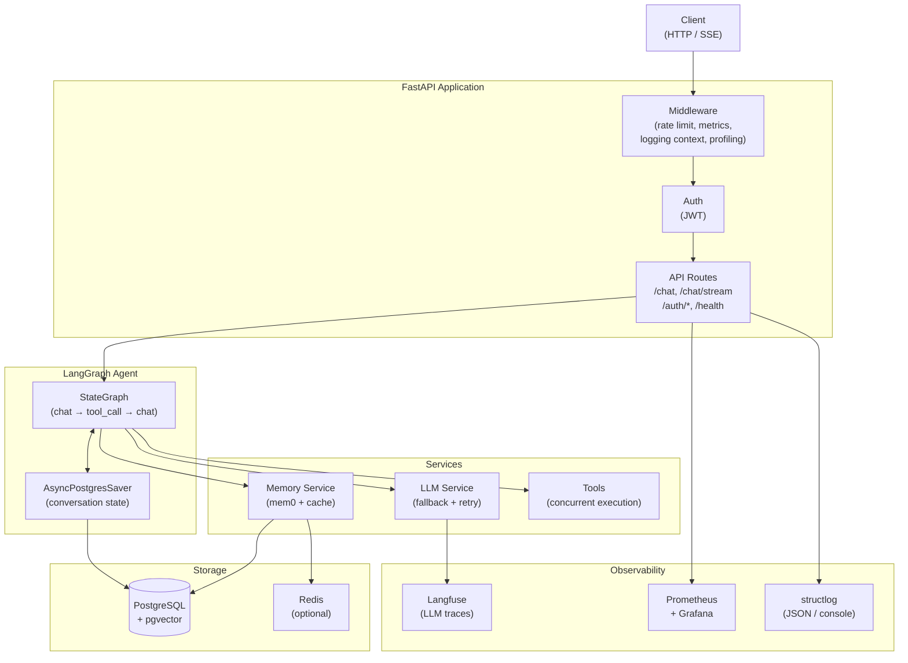
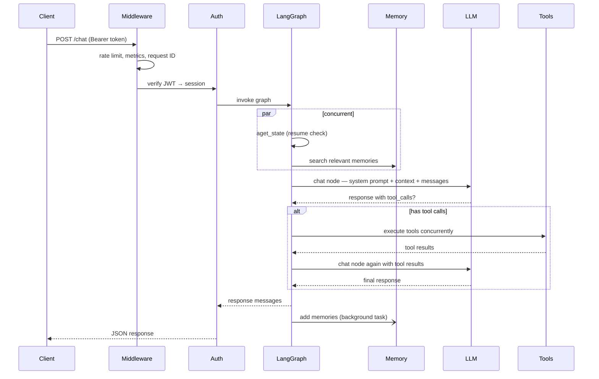
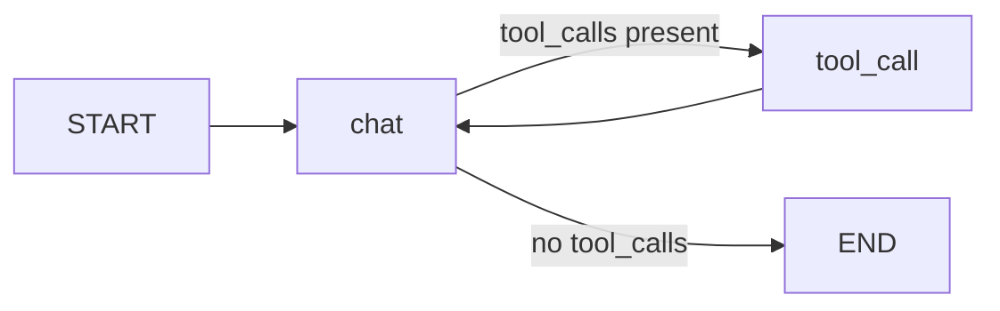

# 架构

## 系统概览

## 请求生命周期

## Agent 图

该 Agent 是一个两节点的 `StateGraph`：

- **`chat` 节点** —— 构建系统提示词、调用 LLM，返回一个 `Command`，路由到 `tool_call` 或 `END`
- **`tool_call` 节点** —— 并发执行所有工具调用，并把结果回传给 `chat`
- **检查点** —— `AsyncPostgresSaver` 按 `thread_id`（会话）持久化完整的 `GraphState`，从而支持中断后恢复和多轮记忆

## 关键设计决策

**记忆检索与状态检查并发执行。** 对每个非恢复类请求，`aget_state`（用于检查是否存在中断）与 `memory.search`（用于获取相关记忆）通过 `asyncio.gather` 并行执行，每次请求可节省 200–500ms。

**工具调用并发执行。** 当 LLM 在一次响应中返回多个工具调用时，它们会通过 `asyncio.gather` 全部并行执行。

**系统提示词在模块加载时缓存。** `system.md` 在启动时只读取一次。每次请求的开销仅是用用户名、当前时间以及检索到的记忆执行一次 `.format()`，没有文件 I/O。

**LLM 回退带总时长限制。** 整个回退循环（重试 × 模型）被包在 `asyncio.wait_for(timeout=LLM_TOTAL_TIMEOUT)` 中，防止无限期挂起。

**用户名通过会话传递，而非每次请求查库。** 用户显示名在会话创建时被复制到 `Session.username`。聊天请求直接从已加载的会话对象中读取，零额外查询。

**会话标题生成不引入额外延迟。** 在未命名会话的第一条消息到达时，API 先用一个占位名（截断后的用户消息）以原子方式抢占该会话，然后启动一个后台 `asyncio.Task` 调用快速 nano 模型并采用结构化输出生成标题。主聊天响应立即返回，标题生成并行进行。Postgres 中的原子 `UPDATE … WHERE name = ''` 确保即使存在并发请求，也只有一个 worker 抢占成功。

## 组件职责

| 组件 | 文件 | 职责 |
|---|---|---|
| LangGraph Agent | `app/core/langgraph/graph.py` | 编排对话循环 |
| LLM 服务 | `app/services/llm/` | 模型注册表、重试、环形回退、结构化输出 |
| 记忆服务 | `app/services/memory.py` | mem0 语义记忆 + 缓存 |
| 会话命名 | `app/services/session_naming.py` | 为新会话在后台生成 LLM 标题 |
| 数据库服务 | `app/services/database.py` | 用户/会话的 CRUD |
| 缓存服务 | `app/core/cache.py` | Redis，带内存回退 |
| 中间件 | `app/core/middleware.py` | 指标采集、日志上下文、性能分析 |
| 认证 | `app/api/v1/auth.py` | JWT 签发、会话管理 |
