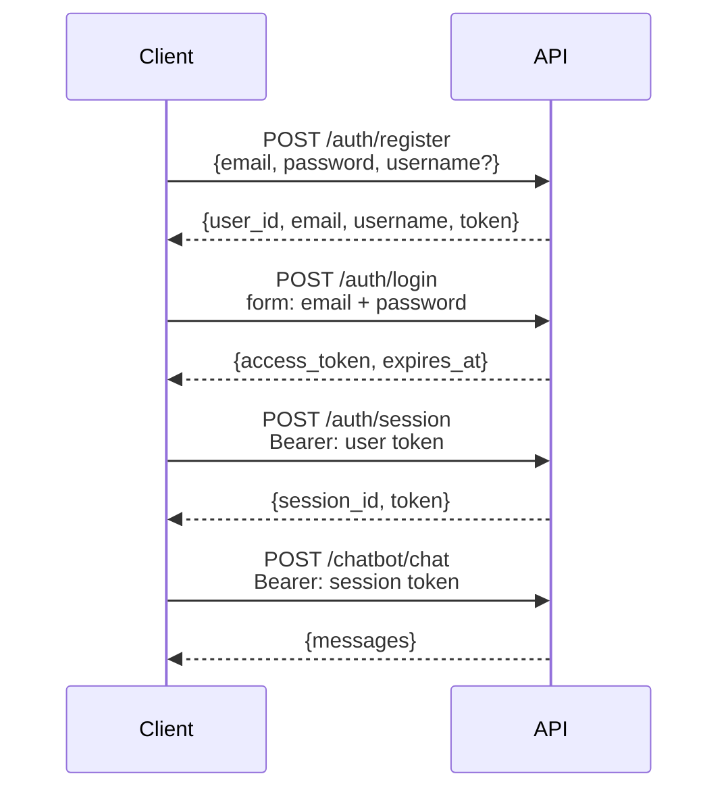

# 认证

## 流程



API 使用**两种 token 作用域**：

- **用户 token** —— 在注册/登录时签发，标识用户身份。用于创建和列出会话。
- **会话 token** —— 按对话会话签发。所有聊天接口都必须携带。作用域限定为单个 `session_id`。

两者都是签名的 JWT（HS256），有效期可配置（`JWT_ACCESS_TOKEN_EXPIRE_DAYS`）。

---

## 接口

### `POST /api/v1/auth/register`

创建新账号。

```json
{
  "email": "you@example.com",
  "password": "Secret123!",  // pragma: allowlist secret
  "username": "you"
}
```

密码要求：至少 8 个字符，包含大写字母、小写字母、数字和特殊字符。

`username` 为可选字段。提供后会传入 Agent 的系统提示词，让 LLM 知道用户的名字。

---

### `POST /api/v1/auth/login`

用凭证换取用户 token。使用 OAuth2 password grant 的表单字段。

```bash
curl -X POST /api/v1/auth/login \
  -F "email=you@example.com" \
  -F "password=Secret123!" \
  -F "grant_type=password"
```

返回 `access_token` 和 `expires_at`。

---

### `POST /api/v1/auth/session`

创建一个新的聊天会话。需要一个有效的用户 token。

```bash
curl -X POST /api/v1/auth/session \
  -H "Authorization: Bearer <user token>"
```

返回 `session_id` 和一个会话级 `token`。后续所有聊天请求都要使用这个会话 token。

---

### `PATCH /api/v1/auth/session/{session_id}/name`

重命名会话。

```bash
curl -X PATCH /api/v1/auth/session/{session_id}/name \
  -H "Authorization: Bearer <session token>" \
  -F "name=My research session"
```

---

### `DELETE /api/v1/auth/session/{session_id}`

删除会话及其聊天历史。

---

### `GET /api/v1/auth/sessions`

列出已认证用户的全部会话。需要用户 token。

---

## 安全说明

- 密码在存储前使用 bcrypt 哈希，明文永远不会落库。
- JWT 中包含 `jti`（JWT ID）声明，用于保证 token 唯一性。
- 所有字符串输入在使用前都会做清洗。
- 限流用于保护注册接口（10 次/小时）和登录接口（20 次/分钟），防止暴力破解。
- 生产环境务必设置足够长的随机 `JWT_SECRET_KEY`，至少 32 个字符。
