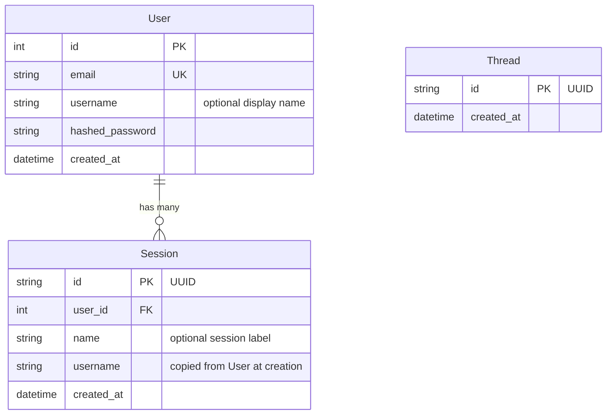

# 数据库与数据库迁移

## 数据结构



**User** —— 每个账号一条。邮箱唯一。`username` 可选，用于个性化系统提示词。

**Session** —— 每个对话一条。一个用户可以拥有多个会话。`username` 在创建时从 `User` 反范式化写入，因此聊天请求无需额外查库。会话 JWT 限定了所有聊天请求的作用域。

**Thread** —— 与 LangGraph 的 `AsyncPostgresSaver` 检查点线程一一对应，用于追踪应用上下文中有哪些线程存在。

LangGraph 检查点还会自建一些表（`checkpoints`、`checkpoint_blobs`、`checkpoint_writes`）—— 这些表由 LangGraph 自身管理，不由 Alembic 管理。

pgvector 会创建一个由 mem0 管理的 `longterm_memory` 集合表 —— 同样不由 Alembic 管理。

---

## 使用 Alembic 进行数据库迁移

所有表结构变更都通过 Alembic 管理。应用启动时不再调用 `create_all()`，表结构完全由 Alembic 负责。

### 初始化（全新数据库）

```bash
make migrate              # applies all migrations to the database
```

### 模型变更后创建数据库迁移

```bash
# 1. Edit your SQLModel model (app/models/)
# 2. Generate the migration
make migration MSG="add phone number to user"

# 3. Review the generated file in alembic/versions/
# 4. Apply it
make migrate
```

### 其他命令

```bash
make migrate-downgrade    # roll back the last migration
make migrate-history      # show the full migration history
```

Alembic 从你的 `.env` 文件读取数据库凭证（经由 `app/core/config.py`）。运行迁移前请确认设置了正确的 `APP_ENV`。

### autogenerate 的工作原理

`env.py` 会导入所有 SQLModel 模型，使其元数据完成注册，然后调用 `alembic revision --autogenerate`。Alembic 将当前数据库结构与模型做差异比对，并生成 upgrade/downgrade 函数。

外部表（LangGraph 检查点、mem0、pgvector）通过 `alembic/env.py` 中的 `include_object` 排除，因此 Alembic 永远不会改动它们。

### 添加新模型

1. 创建 `app/models/your_model.py`
2. 在 `alembic/env.py` 中与其他模型导入一起导入它
3. 运行 `make migration MSG="add your_model table"`

### `alembic.ini` 逐项说明

> **为什么这份配置的注释是英文的**：Alembic 读取 ini 时使用**系统 locale 编码**
> （`alembic/util/compat.py` 里 `read(..., encoding="locale")`），中文 Windows 下即 GBK。
> 一旦文件里出现非 ASCII 字符，任何 alembic 命令都会在解析阶段抛
> `UnicodeDecodeError` 直接失败。所以 `alembic.ini` 保持纯 ASCII，中文说明放在这里。

| 配置项 | 作用 | 说明 |
| --- | --- | --- |
| `script_location` | 迁移脚本目录 | 写成 `%(here)s/alembic`，`%(here)s` 指 ini 所在目录，换工作目录执行也能找到 |
| `file_template` | 迁移文件名模板 | 默认 `%%(rev)s_%%(slug)s`。想带时间前缀就取消注释那一行；ConfigParser 里百分号要写两个 |
| `prepend_sys_path` | 加入 `sys.path` | 必须是 `.`，否则 `env.py` 里 `from app.core.config import settings` 会找不到本项目 |
| `path_separator` | 路径列表分隔符 | 取 `os` 表示用 `os.pathsep`，跨平台自动适配 |
| `sqlalchemy.url` | 数据库连接串 | **故意留空**，由 `env.py` 从 `Settings` 拼装；临时覆盖用环境变量 `SQLALCHEMY_URL` |
| `version_locations` | 多分支脚本目录 | 只有维护多条迁移分支时才需要，首条迁移需配 `--version-path` |
| `recursive_version_locations` | 递归搜索版本目录 | Alembic 1.10+ 才有 |
| `timezone` | 迁移文件里的时区 | 需要 `tzdata`（`pip install "alembic[tz]"`），留空用本机时区 |
| `truncate_slug_length` | slug 最大长度 | 默认 40，标题长时可调大 |
| `revision_environment` | 每次 revision 都跑 env.py | 默认 `false`，省时间 |
| `sourceless` | 允许只有 `.pyc` 的迁移 | 默认 `false` |

`[post_write_hooks]` 里挂了两步 `ruff`：`check --fix` 修问题、`format` 统一格式。
`REVISION_SCRIPT_FILENAME` 是 Alembic 的占位符，会被替换成刚生成的文件路径——
这样 autogenerate 出来的脚本不会一提交就被 pre-commit 打回来。

`[loggers]` 那几段只在 `env.py` 里生效：`root` 压到 `WARNING` 保持输出干净，
`alembic` 保持 `INFO` 以便看到「正在应用哪个 revision」。
排查问题时把 `sqlalchemy` 从 `WARNING` 调到 `INFO`，就能看到每条执行的 SQL。

---

## 为全新数据库启用 pgvector

必须在运行迁移之前启用 pgvector：

```sql
CREATE EXTENSION IF NOT EXISTS vector;
```

使用 Docker 时（`make docker-up`），`db` 服务会自动处理这一步。对于外部数据库（例如 Supabase），请通过控制台或 SQL 编辑器启用该扩展。
