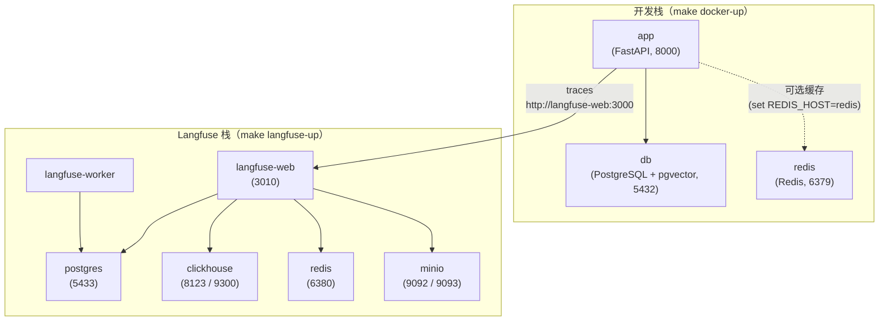

# Docker

## 服务



两套栈通过共享网络 `fly-agent-net` 互通：开发栈创建它，Langfuse 栈以 external 方式加入。
所以 app 容器能用服务名 `langfuse-web` 访问追踪服务，宿主机侧浏览器走 `localhost:3010`。

Redis 始终会启动，但只有在 `.env` 文件中设置了 `REDIS_HOST=redis` 时，应用才会真正使用它。未设置时，应用回退到内存缓存。

> **监控栈已移除**：Prometheus / Grafana / cadvisor 不再属于本编排。逐请求耗时看
> `http_request_completed` 日志，LLM 侧看 Langfuse，容器资源用 `docker stats`。
> 详见[可观测性](observability.md)。

## 常用命令

### 启动 API + 数据库 + Redis（开发时最常用）

```bash
make docker-up ENV=development     # start
make docker-down ENV=development   # stop
make docker-logs ENV=development   # tail logs
```

### 构建自定义镜像

```bash
make docker-build ENV=production
```

该命令会执行 `scripts/build-docker.sh`，为指定环境构建并打标签镜像。

## 在 Docker 中运行数据库迁移

执行 `make docker-up` 之后，对容器中的数据库运行迁移：

```bash
make migrate ENV=development
```

该命令会加载对应的 `.env` 文件，并在你本机上执行 `alembic upgrade head`，连接到容器中的 PostgreSQL。

## 环境变量文件

每个环境都需要一个 `.env.<env>` 文件：

```bash
cp .env.example .env.development
cp .env.example .env.staging
cp .env.example .env.production
```

`make docker-up` 命令通过 `--env-file` 把环境变量文件传给 Docker Compose。Docker 环境变量文件中务必设置 `POSTGRES_HOST=db`（而不是 `localhost`）—— Compose 网络内该服务的名称就是 `db`。`LANGFUSE_HOST` 无需手改，编排文件已覆盖为 `http://langfuse-web:3000`。

## Langfuse（自建追踪栈）

```bash
make langfuse-up ENV=development    # 起 Web + Worker + Postgres + ClickHouse + Redis + MinIO
make langfuse-logs                  # 跟 web / worker 日志
make langfuse-down                  # 停栈（数据卷保留）
```

启动后访问 [http://localhost:3010](http://localhost:3010)，首屏建组织与项目，在项目设置里
取 `pk-` / `sk-` 填进 `.env.development` 的 `LANGFUSE_PUBLIC_KEY` / `LANGFUSE_SECRET_KEY`，
再把 `LANGFUSE_TRACING_ENABLED` 置为 `true`。

首次启动需要 1~2 分钟建表；常驻内存约 1.5~2GB。端口全部避让开发栈（见上方拓扑图）。
清空数据用 `docker compose -f docker-compose.langfuse.yml down -v`。
