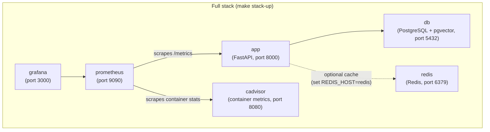

# Docker

## 服务



Redis 始终会启动，但只有在 `.env` 文件中设置了 `REDIS_HOST=redis` 时，应用才会真正使用它。未设置时，应用回退到内存缓存。

## 常用命令

### 仅启动 API + 数据库（开发时最常用）

```bash
make docker-up ENV=development     # start
make docker-down ENV=development   # stop
make docker-logs ENV=development   # tail logs
```

### 完整技术栈（包含 Prometheus + Grafana）

```bash
make stack-up ENV=development      # start everything
make stack-down ENV=development    # stop everything
make stack-logs ENV=development    # tail all service logs
```

### 构建自定义镜像

```bash
make docker-build ENV=production
```

该命令会执行 `scripts/build-docker.sh`，为指定环境构建并打标签镜像。

## 在 Docker 中运行数据库迁移

执行 `make docker-up` 之后，对容器中的数据库运行迁移：

```bash
make migrate ENV=development
```

该命令会加载对应的 `.env` 文件，并在你本机上执行 `alembic upgrade head`，连接到容器中的 PostgreSQL。

## 环境变量文件

每个环境都需要一个 `.env.<env>` 文件：

```bash
cp .env.example .env.development
cp .env.example .env.staging
cp .env.example .env.production
```

`docker-up` 和 `stack-up` 命令通过 `--env-file` 把环境变量文件传给 Docker Compose。Docker 环境变量文件中务必设置 `POSTGRES_HOST=db`（而不是 `localhost`）—— Compose 网络内该服务的名称就是 `db`。

## Grafana

执行 `make stack-up` 后，Grafana 可通过 [http://localhost:3000](http://localhost:3000) 访问。

默认凭证：`admin` / `admin`

预置的看板（位于 `grafana/`）：

- API 性能（请求速率、延迟、错误率）
- 限流统计
- 数据库连接池健康状态
- 系统资源使用情况
