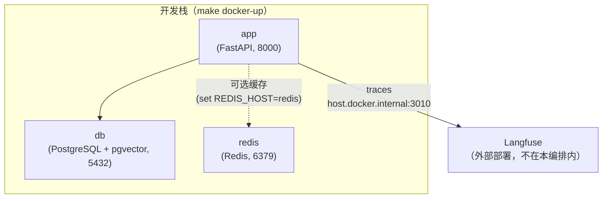

# Docker

## 服务



**Langfuse 不在这份编排里。** 它由你单独部署（自己的 compose、内网服务或云端），
本仓库只负责把 trace 发过去：在 `.env` 里填 `LANGFUSE_HOST` 与 `pk-` / `sk-` 即可。
app 容器内的默认值是 `http://host.docker.internal:3010`（容器里的 `localhost` 指容器自己），
Langfuse 在别的地址就用 `LANGFUSE_HOST_INTERNAL` 覆盖。详见[可观测性](observability.md)。

Redis 始终会启动，但只有在 `.env` 文件中设置了 `REDIS_HOST=redis` 时，应用才会真正使用它。未设置时，应用回退到内存缓存。

> **监控栈已移除**：Prometheus / Grafana / cadvisor 不再属于本编排。逐请求耗时看
> `http_request_completed` 日志，LLM 侧看 Langfuse，容器资源用 `docker stats`。
> 详见[可观测性](observability.md)。

## 常用命令

### 启动 API + 数据库 + Redis（开发时最常用）

```bash
make docker-up ENV=development     # start
make docker-down ENV=development   # stop
make docker-logs ENV=development   # tail logs
```

### 构建自定义镜像

```bash
make docker-build ENV=production
```

该命令会执行 `scripts/build-docker.sh`，为指定环境构建并打标签镜像。

## 在 Docker 中运行数据库迁移

执行 `make docker-up` 之后，对容器中的数据库运行迁移：

```bash
make migrate ENV=development
```

该命令会加载对应的 `.env` 文件，并在你本机上执行 `alembic upgrade head`，连接到容器中的 PostgreSQL。

## 环境变量文件

每个环境都需要一个 `.env.<env>` 文件：

```bash
cp .env.example .env.development
cp .env.example .env.staging
cp .env.example .env.production
```

`make docker-up` 命令通过 `--env-file` 把环境变量文件传给 Docker Compose。Docker 环境变量文件中务必设置 `POSTGRES_HOST=db`（而不是 `localhost`）—— Compose 网络内该服务的名称就是 `db`。

`LANGFUSE_HOST` 无需手改：编排会把容器内的值覆盖成 `http://host.docker.internal:3010`（打到宿主机上的实例）。Langfuse 不在宿主机 3010 端口时，用 `LANGFUSE_HOST_INTERNAL` 覆盖一次即可。

## Langfuse

Langfuse 由外部独立部署，本编排不包含它，也没有对应的 Makefile 目标。接上它只需要两步：

1. 在你那套 Langfuse 的项目设置里取 `pk-` / `sk-`，填进 `.env.development`
2. 把 `LANGFUSE_HOST` 改成它实际监听的地址，`LANGFUSE_TRACING_ENABLED=true`

```bash
make trace-smoke     # 造一条探针 trace，确认 key 通、数据到、界面能看到
```
