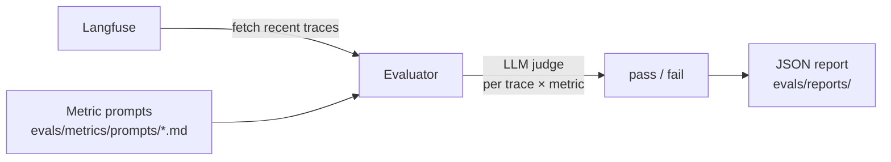

# 评测

本项目内置一套基于指标的评测框架：从 Langfuse 拉取链路追踪数据，用 LLM 打分器评分，并生成 JSON 报告。

## 运行评测

```bash
make eval                        # interactive mode — prompts for settings
make eval-quick                  # runs with defaults, no prompts
make eval-no-report              # runs but skips report generation
make eval ENV=production         # run against production traces
```

## 工作流程



1. **拉取链路追踪** —— 从 Langfuse 获取近期的 LLM 追踪数据（通过 `LANGFUSE_*` 环境变量配置）
2. **评分** —— 对每个「追踪 × 指标」组合，由 LLM 打分器评估输出并返回 pass/fail
3. **生成报告** —— 包含汇总统计和逐条追踪结果的 JSON 报告会保存到 `evals/reports/`

## 内置指标

| 指标 | 检查内容 |
| --- | --- |
| `helpfulness` | 响应是否真正帮到了用户？ |
| `conciseness` | 响应是否足够简洁？ |
| `hallucination` | 响应中是否包含编造的事实？ |
| `relevancy` | 响应是否切题？ |
| `toxicity` | 响应中是否包含有害内容？ |

## 添加自定义指标

1. 在 `evals/metrics/prompts/` 中创建一个 Markdown 文件：

```markdown
# My Metric

Evaluate whether the assistant response...

## Scoring

Return "pass" if... Return "fail" if...
```

2. 评测器会自动发现并应用该目录下的所有 `.md` 文件。

## 报告格式

报告保存到 `evals/reports/evaluation_report_YYYYMMDD_HHMMSS.json`：

```json
{
  "summary": {
    "total_traces": 50,
    "success_rate": 0.92,
    "duration_seconds": 34.2
  },
  "metrics": {
    "helpfulness": {"pass": 48, "fail": 2, "rate": 0.96},
    "hallucination": {"pass": 45, "fail": 5, "rate": 0.90}
  },
  "traces": [...]
}
```

## 评测用 LLM 配置

评测器使用独立的 LLM 配置，因此你可以换用另一个（更便宜的）模型来做打分：

```bash
EVALUATION_LLM=gpt-5
EVALUATION_API_KEY=...   # defaults to OPENAI_API_KEY if not set
```
