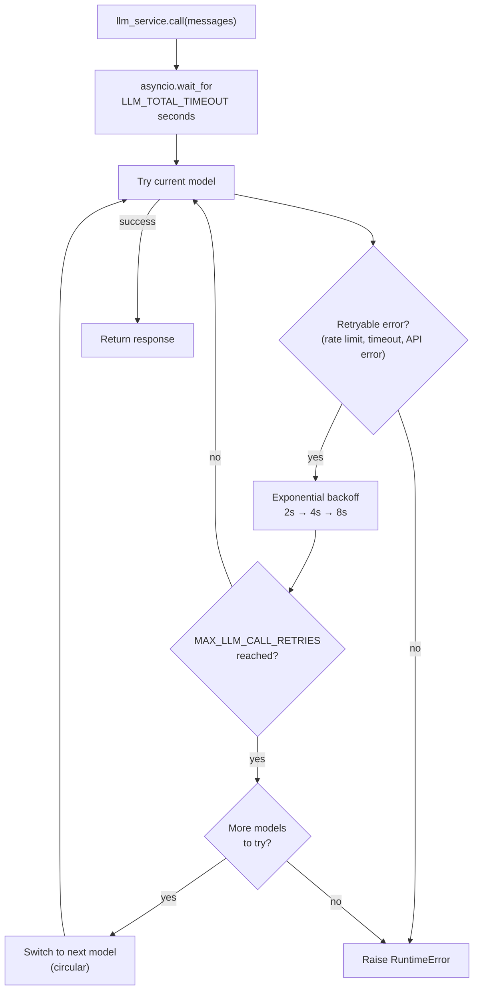

# LLM 服务

## 概述

LLM 服务（`app/services/llm/`）负责所有语言模型调用，内置自动重试、循环模型回退和总超时预算。你的 agent 代码只调用 `llm_service.call(messages)` —— 其余一切由该服务处理。

这个包拆成两个模块：

- `app/services/llm/registry.py` —— `LLMRegistry`：定义可用模型
- `app/services/llm/service.py` —— `LLMService`：调用逻辑、重试、回退、结构化输出

## 模型注册表

模型按优先级顺序定义在 `LLMRegistry.LLM_CONFIGS` 中：

| 名称           | 模型         | 说明                                |
| -------------- | ------------ | ----------------------------------- |
| `gpt-5.6-luna` | gpt-5.6-luna | 默认。中等推理强度。                |
| `gpt-5.4`      | gpt-5.4      | 中等推理强度。                      |
| `gpt-5.4-mini` | gpt-5.4-mini | 低推理强度。                        |
| `gpt-5.4-nano` | gpt-5.4-nano | 快，低推理强度。                    |

在 `.env` 里设置 `DEFAULT_LLM_MODEL` 来选择起始模型。

每个条目都通过 LangChain 的 `init_chat_model` 构建。裸 `model` 名（也就是上面那些）会被推断为 OpenAI，因此现有条目和环境变量都保持原样可用。要添加其他提供方的模型，给 `model` 加上 `provider:` 前缀，例如：

```python
{"name": "claude-opus", "model": "anthropic:claude-opus-4-6", "kwargs": {"temperature": 0.2}},
```

必须安装该提供方的 LangChain 集成包（`uv sync --extra anthropic`、`--extra ollama` 或 `--extra google-genai`），并通过该提供方自己的环境变量设置 API key（例如 `ANTHROPIC_API_KEY`）—— 注册表本身不管理非 OpenAI 的凭证。

要新增或修改模型，编辑 `app/services/llm/registry.py` 里的 `LLMRegistry.LLM_CONFIGS`。

## 重试与回退行为



**重试配置**（按模型）：

- 最大尝试次数：`MAX_LLM_CALL_RETRIES`（默认：3）
- 等待：指数退避，最短 2s，最长 10s
- 触发重试的异常：`openai` 的 `RateLimitError`、`APITimeoutError`、`APIError`

  这些都是 OpenAI 专有的异常类型。非 OpenAI 的注册表条目（例如 `anthropic:claude-opus-4-6`）遇到任何异常时仍会循环回退到下一个模型，但在把该提供方的错误类型加进这个元组之前，不会享受按模型进行的指数退避重试。

**总超时**：`LLM_TOTAL_TIMEOUT` 秒（默认：60s）封顶整个循环。没有它的话，最坏情况是 `retries × models × max_wait` —— 可能超过 2 分钟。

**回退顺序**：沿 `LLMRegistry.LLMS` 循环。走完最后一个模型后回到第一个，跑满一轮即停止。

## 工具

工具在启动时绑定到 LLM：

```python
llm_service.bind_tools(tools)
```

回退过程中切换模型时，工具会自动重新绑定到新模型。

## 结构化输出

把 Pydantic 模型作为 `response_format` 传入，就能拿回校验后的实例，而不是原始的 `BaseMessage`：

```python
from app.schemas.my_schema import MySchema

result: MySchema = await llm_service.call(
    messages,
    model_name="gpt-5.4-nano",   # optional — uses current default if omitted
    response_format=MySchema,
    temperature=0.2,
)
```

服务会在解析出的模型上链式调用 `.with_structured_output(schema)`，并在每一次回退尝试时重新包装，因此重试和模型切换对调用方完全透明。

## 新增模型

```python
# app/services/llm/registry.py — LLMRegistry.LLM_CONFIGS
{
    "name": "gpt-5.4",
    "model": "gpt-5.4",  # or "provider:model", e.g. "anthropic:claude-opus-4-6"
    "kwargs": {
        "max_completion_tokens": settings.MAX_TOKENS,
        "reasoning": {"effort": "medium"},  # OpenAI-only; drop for other providers
    },
},
```

可以加在列表的任意位置。回退顺序跟随列表顺序。
