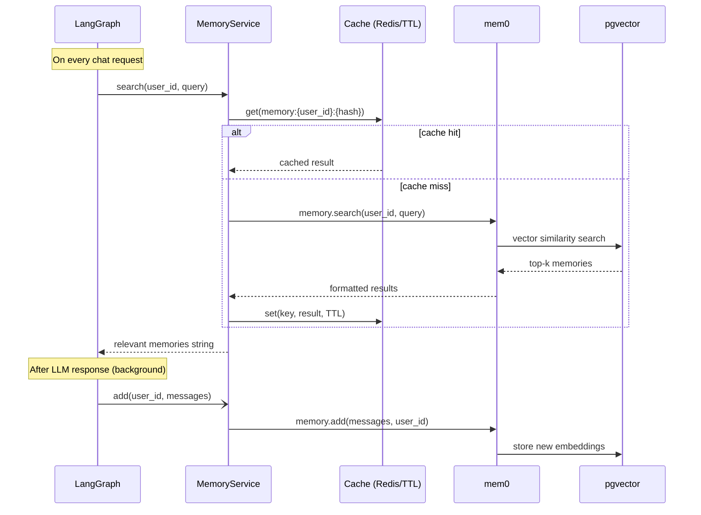

# 记忆

## 概述

模板内置长期记忆系统，由 [mem0](https://github.com/mem0ai/mem0) 和 pgvector 驱动。记忆从对话中抽取、以向量嵌入的形式存储，并在每次请求时按语义检索 —— 让 agent 拥有以往会话的上下文。

## 工作原理

## 缓存层

记忆检索结果会被缓存，避免在同一 TTL 窗口内对相似问题重复查询 pgvector。

- **使用 Redis 时**：缓存在多个应用实例间共享。在 `.env` 里设置 `REDIS_HOST`。
- **不使用 Redis 时**：回退到进程内 `TTLCache` —— 单实例场景完全够用。

缓存 key：`memory:{user_id}:{sha256(query)[:16]}`
TTL：`CACHE_TTL_SECONDS`（默认：60s）

只缓存成功且非空的结果。错误永不缓存。

## 记忆更新

LLM 产出响应后，记忆通过 `asyncio.create_task` **在后台**更新。这意味着：
- 响应立即返回，无需等待 mem0 处理完成
- 记忆更新不会阻塞或拖慢对话响应

## 配置

| 变量 | 默认值 | 说明 |
| --- | --- | --- |
| `LONG_TERM_MEMORY_COLLECTION_NAME` | `longterm_memory` | pgvector 集合名 |
| `LONG_TERM_MEMORY_MODEL` | `gpt-5-nano` | mem0 用于抽取和处理记忆的 LLM |
| `LONG_TERM_MEMORY_EMBEDDER_MODEL` | `text-embedding-3-small` | 用于语义检索的向量嵌入模型 |
| `CACHE_TTL_SECONDS` | `60` | 记忆检索缓存 TTL |

## 启动预热

启动时，应用 lifespan 会调用 `memory_service.initialize()`。它会建立 pgvector 连接池并执行 mem0 的 schema 检查，这样第一个用户请求就不用承担约 130ms 的冷启动开销。

## 用户隔离

每个用户的记忆都以 `user_id` 作为命名空间独立存储和检索。用户之间无法访问彼此的记忆。
