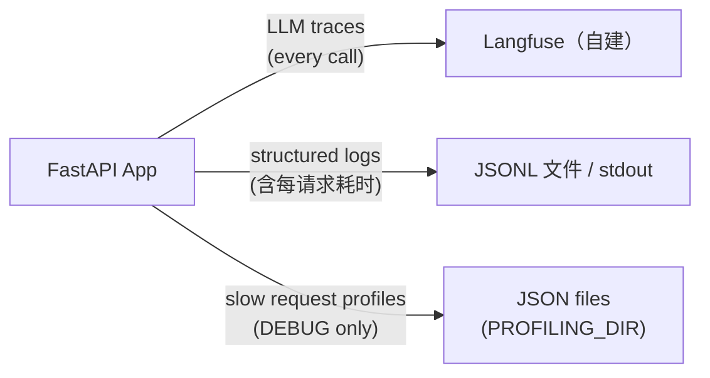

# 可观测性

## 概述



两条主线：**LLM 内部发生了什么**看 Langfuse，**服务这一层发生了什么**看日志。
通用的 Prometheus 指标栈已从脚手架移除，理由见「请求级观测」一节。

---

## Langfuse —— LLM 链路追踪

每次 LLM 调用都通过 LangChain 的 `CallbackHandler` 追踪。追踪信息包含：

- 输入消息与输出
- Token 用量与成本
- 单次调用和单个会话的延迟
- 模型名、temperature 及其他参数

**本仓库不部署 Langfuse**。你那套实例（自己写的 compose、公司内网、云上）单独跑，
本项目只负责把 trace 发过去——填地址和 key 就够了：

```bash
LANGFUSE_TRACING_ENABLED=true
LANGFUSE_PUBLIC_KEY=pk-...
LANGFUSE_SECRET_KEY=sk-...
LANGFUSE_HOST=http://localhost:3010        # 换成你实际的地址与端口
```

key 在你那套 Langfuse 的「项目 → Settings → API Keys」里取。

**app 换位置跑时，地址要跟着换：**

| app 跑在哪 | `LANGFUSE_HOST` 填什么 | 说明 |
| --- | --- | --- |
| 宿主机 `make dev` | `http://localhost:<端口>` | 直连，最简单 |
| 容器 `make docker-up` | 不用改 `.env` | 编排自动覆盖成 `http://host.docker.internal:<同一端口>` |
| app 与 Langfuse 同网络 | `LANGFUSE_HOST_INTERNAL=http://langfuse-web:3000` | 把 app 接进 Langfuse 的网络后用服务名 |
| Langfuse 在别的机器 | `LANGFUSE_HOST_INTERNAL=http://<ip>:<端口>` | 容器内覆盖，宿主机侧同时改 `.env` |
| 云端 Hobby | `https://cloud.langfuse.com` | 免费额度 5 万 units/月 |

> 容器里的 `localhost` 指 app 自己，这是唯一一个容易踩的坑。默认的
> `host.docker.internal` 在 Docker Desktop（Windows / macOS）上开箱可用；
> compose 里已加 `extra_hosts: host-gateway`，Linux 宿主也能解析。

端口、数据卷、版本升级都是你那套部署的事，本仓库不管。

**临时关闭：**

```bash
LANGFUSE_TRACING_ENABLED=false
```

`LANGFUSE_HOST` 指错或 key 不匹配时，`langfuse_init()` 只记一条
`langfuse_auth_failure` 告警，不会阻断服务启动——追踪是旁路能力。

**会话与用户归因：** LangGraph 侧只认 metadata 里三个带前缀的键——`langfuse_session_id`、`langfuse_user_id`、`langfuse_tags`。写成 `session_id` 会被当作普通元数据存着，界面上「会话」页与按用户统计永远是空的。请求入口用 `trace_attributes()` 包一次即可，图内所有节点自动继承：

```python
with trace_attributes(session_id=session.id, user_id=str(session.user_id), tags=["chat"]):
    await agent.get_response(...)
```

**自检与报表：**

```bash
make trace-smoke              # 造一条探针 trace，验证「key 通、数据到、界面能看到」
make trace-report HOURS=24    # 把最近一段时间的量、成本、延迟聚合成终端表格
```

命令行脚本跑完就退出，不调 `flush()` 会丢掉缓冲区里的追踪——`observability.flush()` 就是给脚本用的。

追踪数据同时也是[评测框架](evaluation.md)的数据源。

---

## 结构化日志

所有日志统一使用 [structlog](https://www.structlog.org/)，格式一致：

- **开发环境**：彩色控制台输出
- **生产环境**：JSON（管道给你的日志聚合器）

只要可用，每行日志都会自动带上 `request_id`、`session_id` 和 `user_id` —— 由 `LoggingContextMiddleware` 绑定。

每个请求结束时该中间件还会打一条 `http_request_completed`，带 `method`、`path`、
`status_code` 与 `duration_ms`。这是原来 Prometheus histogram 的位置，现在它是唯一的
逐请求耗时来源，慢请求排查从这里开始。

### 日志格式约定

```python
# Good
logger.info("chat_request_received", session_id=session.id, message_count=5)

# Never
logger.info(f"chat request received for {session.id}")  # no f-strings
logger.error("something failed", error=str(e))          # use logger.exception for exceptions
```

规则：

- 事件名使用 `lowercase_with_underscores`
- 变量一律用关键字参数传入，绝不插值进事件字符串
- 在 `except` 块内用 `logger.exception()`（而不是 `.error()`）—— 可保留完整 traceback

### 各环境的日志级别

| 环境 | 级别 |
| --- | --- |
| development | DEBUG |
| staging | INFO |
| production | WARNING |

---

## 请求级观测（日志承担）

原 Prometheus + Grafana + cadvisor 三件套已从脚手架移除，`/metrics` 端点不再暴露。理由：

- **LLM 侧的延迟/成本/调用链由 Langfuse 覆盖**，比通用指标更贴近 Agent 排障
- **cadvisor 在 Docker Desktop（Windows/macOS）拿不到有意义的容器数据**，等于白跑一个容器
- 三个常驻容器约 300–500MB 内存，对本地开发是持续成本

替代方案是三条现成的东西：

| 想知道什么 | 用什么 |
| --- | --- |
| 每个请求多快、什么状态码 | `http_request_completed` 日志（`method` / `path` / `status_code` / `duration_ms`） |
| 慢请求卡在哪个函数 | `ProfilingMiddleware` 落盘的调用树（见下节） |
| 某次 LLM 调用花了多少 token | Langfuse 的 trace 详情 |
| 容器 CPU / 内存 | `docker stats` 现查 |

`LoggingContextMiddleware` 在请求结束时打一条：

```json
{"message": "http_request_completed", "method": "POST", "path": "/api/v1/chatbot/chat",
 "status_code": 200, "duration_ms": 1842.37, "request_id": "...", "session_id": "..."}
```

捞最慢的请求：

```bash
cat logs/development-*.jsonl \
  | jq -r 'select(.message=="http_request_completed") | "\(.duration_ms)\t\(.method) \(.path)\t\(.status_code)"' \
  | sort -rn | head -20
```

按状态码数错误率：

```bash
cat logs/development-*.jsonl \
  | jq -r 'select(.message=="http_request_completed" and .status_code>=500) | .path' \
  | sort | uniq -c | sort -rn
```

要接回指标栈时，装 `prometheus-client` 与 `starlette-prometheus`、在 `main.py` 恢复
`setup_metrics(app)`，再把 Prometheus 服务加回 compose 即可——中间件位置和生命周期钩子都还在。

---

## 请求性能剖析（仅 DEBUG）

当 `DEBUG=true` 时，`ProfilingMiddleware` 会用 [pyinstrument](https://github.com/joerick/pyinstrument) 剖析每个请求。请求耗时超过 `PROFILING_THRESHOLD_SECONDS` 时，一份 JSON 报告会保存到 `PROFILING_DIR`。

每个报告文件命名为 `{request_id}.json`，内容包含：

```json
{
  "request_id": "...",
  "endpoint": "POST /api/v1/chatbot/chat",
  "wall_time_ms": 1842,
  "cpu_time_ms": 145,
  "io_wait_ms": 1697,
  "memory_peak_kb": 4820,
  "top_memory_allocators": [...],
  "call_tree": {...}
}
```

设 `PROFILING_THRESHOLD_SECONDS=0` 即可剖析每个请求。

文件名里的 `request_id` 与响应头 `X-Request-ID` 一致，因此可以把剖析报告与具体日志行对应起来。

---

## 请求 ID 传递

每个请求都会通过 [`asgi-correlation-id`](https://github.com/snok/asgi-correlation-id) 拿到唯一的 `X-Request-ID` 请求头。这个 ID 会：

- 出现在响应头中返回
- 绑定到该请求的每一行日志
- 用作性能剖析报告的文件名

用响应里的 `X-Request-ID` 去 grep 日志、定位剖析报告、查询这个请求对应的 Langfuse 追踪。
