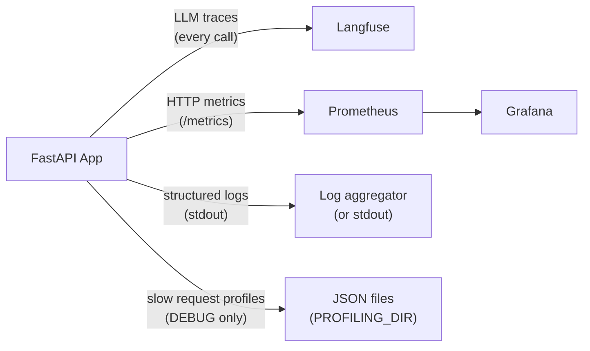

# 可观测性

## 概述



---

## Langfuse —— LLM 链路追踪

每次 LLM 调用都通过 LangChain 的 `CallbackHandler` 追踪。追踪信息包含：

- 输入消息与输出
- Token 用量与成本
- 单次调用和单个会话的延迟
- 模型名、temperature 及其他参数

**配置：**

```bash
LANGFUSE_TRACING_ENABLED=true
LANGFUSE_PUBLIC_KEY=pk-...
LANGFUSE_SECRET_KEY=sk-...
LANGFUSE_HOST=https://cloud.langfuse.com   # or your self-hosted URL
```

**本地开发时关闭：**

```bash
LANGFUSE_TRACING_ENABLED=false
```

**会话与用户归因：** LangGraph 侧只认 metadata 里三个带前缀的键——`langfuse_session_id`、`langfuse_user_id`、`langfuse_tags`。写成 `session_id` 会被当作普通元数据存着，界面上「会话」页与按用户统计永远是空的。请求入口用 `trace_attributes()` 包一次即可，图内所有节点自动继承：

```python
with trace_attributes(session_id=session.id, user_id=str(session.user_id), tags=["chat"]):
    await agent.get_response(...)
```

**自检与报表：**

```bash
make trace-smoke              # 造一条探针 trace，验证「key 通、数据到、界面能看到」
make trace-report HOURS=24    # 把最近一段时间的量、成本、延迟聚合成终端表格
```

命令行脚本跑完就退出，不调 `flush()` 会丢掉缓冲区里的追踪——`observability.flush()` 就是给脚本用的。

**自建：** `make langfuse-up` 起全套（Web + Worker + Postgres + ClickHouse + Redis + MinIO，界面在 <http://localhost:3010>，端口已避让开发栈），`make langfuse-down` 收工。数据敏感、不能出内网时才值得自建，日常开发直接用云端免费额度即可。

追踪数据同时也是[评测框架](evaluation.md)的数据源。

---

## 结构化日志

所有日志统一使用 [structlog](https://www.structlog.org/)，格式一致：

- **开发环境**：彩色控制台输出
- **生产环境**：JSON（管道给你的日志聚合器）

只要可用，每行日志都会自动带上 `request_id`、`session_id` 和 `user_id` —— 由 `LoggingContextMiddleware` 绑定。

### 日志格式约定

```python
# Good
logger.info("chat_request_received", session_id=session.id, message_count=5)

# Never
logger.info(f"chat request received for {session.id}")  # no f-strings
logger.error("something failed", error=str(e))          # use logger.exception for exceptions
```

规则：

- 事件名使用 `lowercase_with_underscores`
- 变量一律用关键字参数传入，绝不插值进事件字符串
- 在 `except` 块内用 `logger.exception()`（而不是 `.error()`）—— 可保留完整 traceback

### 各环境的日志级别

| 环境 | 级别 |
| --- | --- |
| development | DEBUG |
| staging | INFO |
| production | WARNING |

---

## Prometheus 指标

指标暴露在 `GET /metrics`，由 Prometheus 抓取。

| 指标 | 类型 | 说明 |
| --- | --- | --- |
| `http_requests_total` | Counter | 按方法、接口、状态码统计的请求数 |
| `http_request_duration_seconds` | Histogram | 按方法、接口统计的请求延迟 |
| `llm_inference_duration_seconds` | Histogram | 按模型统计的 LLM 调用延迟 |
| `llm_stream_duration_seconds` | Histogram | 按模型统计的流式调用延迟 |
| `session_names_generated_total` | Counter | 会话标题生成次数，按成功 / 失败区分 |
| `starlette_requests_total` 等 `starlette_*` | — | 框架中间件自带（QPS、进行中请求） |
| `db_connections` | Gauge | 已定义，**但没有任何地方打点，恒为 0** |
| `orders_processed_total` | Counter | 模板遗留，**当前无打点，Prometheus 里查不到** |

### 看板

`grafana/` 下两块看板，随容器启动自动导入：

| 文件 | 看什么 |
| --- | --- |
| `dashboards/json/service_overview.json` | QPS、5xx 错误率、处理中请求、HTTP P95、LLM 流式/非流式 P95、会话标题生成 |
| `dashboards/json/llm_latency.json` | LLM 推理与流式的 P95、均值、调用量 |

数据源也是文件化的（`grafana/datasources/datasource.yml`，uid 固定为 `prometheus`）。
**只挂看板不挂数据源，面板会显示 “Datasource prometheus was not found”，六块图全空**——这个现象很像「指标没上报」，实际只是数据源没配，排查时先看这一步。

用 `make stack-up ENV=development` 启动整套服务，[http://localhost:3000](http://localhost:3000) 访问（admin/admin）；
`make stack-up` 会一起拉起 Prometheus（9090）、Grafana（3000）与 cadvisor（8080）。
cadvisor 只对 Linux 宿主有效，Docker Desktop 下拿不到容器数据，可整段删掉。

---

## 请求性能剖析（仅 DEBUG）

当 `DEBUG=true` 时，`ProfilingMiddleware` 会用 [pyinstrument](https://github.com/joerick/pyinstrument) 剖析每个请求。请求耗时超过 `PROFILING_THRESHOLD_SECONDS` 时，一份 JSON 报告会保存到 `PROFILING_DIR`。

每个报告文件命名为 `{request_id}.json`，内容包含：

```json
{
  "request_id": "...",
  "endpoint": "POST /api/v1/chatbot/chat",
  "wall_time_ms": 1842,
  "cpu_time_ms": 145,
  "io_wait_ms": 1697,
  "memory_peak_kb": 4820,
  "top_memory_allocators": [...],
  "call_tree": {...}
}
```

设 `PROFILING_THRESHOLD_SECONDS=0` 即可剖析每个请求。

文件名里的 `request_id` 与响应头 `X-Request-ID` 一致，因此可以把剖析报告与具体日志行对应起来。

---

## 请求 ID 传递

每个请求都会通过 [`asgi-correlation-id`](https://github.com/snok/asgi-correlation-id) 拿到唯一的 `X-Request-ID` 请求头。这个 ID 会：

- 出现在响应头中返回
- 绑定到该请求的每一行日志
- 用作性能剖析报告的文件名

用响应里的 `X-Request-ID` 去 grep 日志、定位剖析报告、查询这个请求对应的 Langfuse 追踪。
